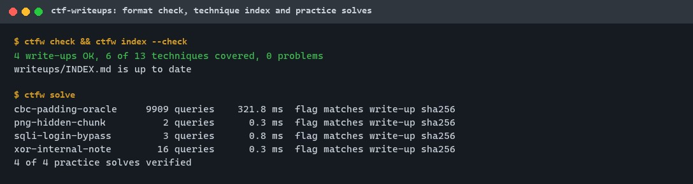
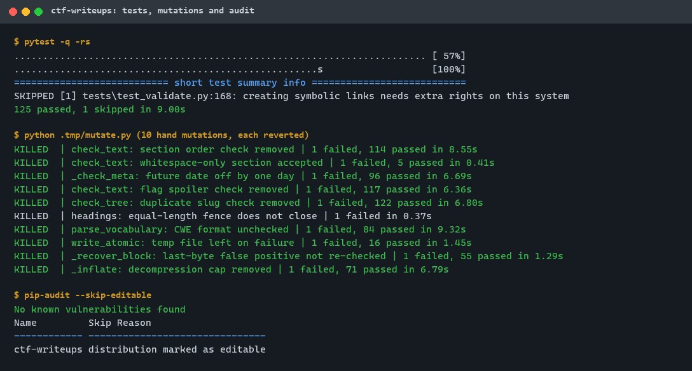
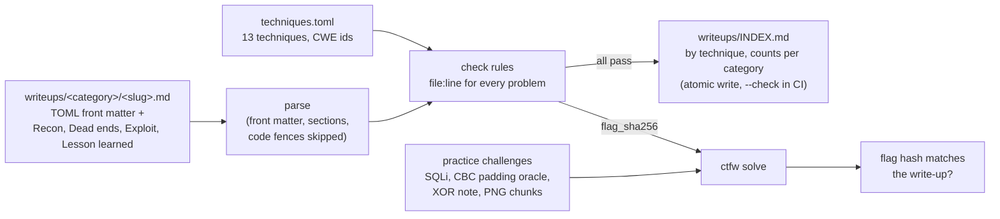
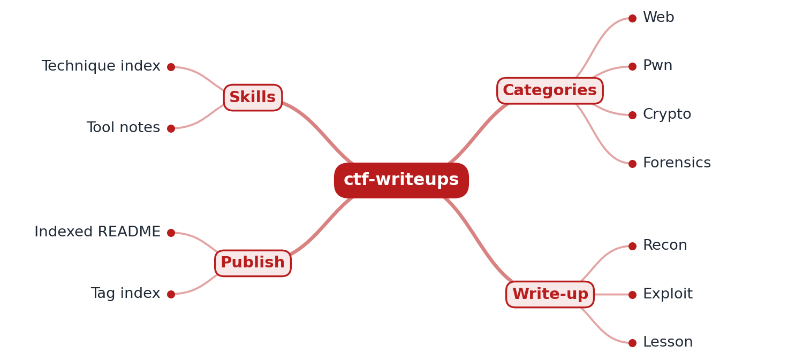
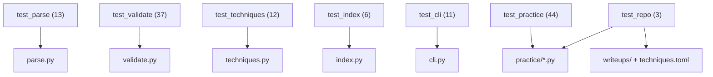

# ctf-writeups

[](https://github.com/EquinoxWN/ctf-writeups/actions/workflows/ci.yml)


> Capture-the-flag write-ups in one checked format (recon, dead ends, exploit, lesson learned), indexed by technique, with practice challenges whose solves are run and verified in CI.

Part of my **Cyber Security** list · Python · Markdown

## Proof it works

`ctfw check` validates every write-up against the format and the technique vocabulary, `ctfw index --check` confirms the technique index is current, and `ctfw solve` runs the four practice exploits against the challenges shipped in this repo and compares each recovered flag with the sha256 stored in its write-up:



125 tests pass locally (1 symbolic-link test runs in CI on Linux), 10 of 10 hand mutations of the core functions are killed, and `pip-audit` finds no known vulnerabilities:



## Architecture

**What M1 runs today:**



**Full roadmap (M1 to M3):**



## How it works

_Steps 1 and 2 are built and tested (M1); the rest is on the [roadmap](#roadmap)._

1. Every write-up follows one format: recon, dead ends, exploit, lesson learned.
2. Challenges are indexed by technique: SQL injection, ROP, padding oracle and so on.
3. Exploit scripts use pwntools and are runnable.
4. Only retired challenges are published, following each platform's rules.
5. An indexed README links every write-up by category and technique.
6. A skill matrix shows progress over time.

### The format

```toml
+++
title = "Session token through a CBC padding oracle"
slug = "cbc-padding-oracle"          # = file name; file lives in writeups/<category>/
category = "crypto"                  # web, pwn, crypto, forensics, reversing, misc
platform = "ctf-writeups practice set"
event = "Practice set, challenge 2"
solved = 2026-11-08                  # TOML date, not after today (UTC)
difficulty = "medium"                # easy, medium, hard
techniques = ["padding-oracle"]      # ids from techniques.toml
flag_sha256 = "de74...1ad0"          # the flag itself is never written
summary = "..."                      # optional
+++

## Recon
## Dead ends
## Exploit
## Lesson learned
```

Each section appears once, in this order, and is not empty; `###` subsections are free. A write-up that contains the flag whose hash it records is rejected as a spoiler.

## Who it helps

- **Who:** CTF players and security learners who keep their own write-ups, and readers who want to learn one technique at a time.
- **The problem:** personal write-up collections drift (no failed attempts, flags pasted in, no way to find every write-up on one technique), and nothing catches it.
- **How to use it:** write with `ctfw new`, run `ctfw check` (locally or in CI) to enforce the format and vocabulary, and `ctfw index` to get a by-technique index. The four practice write-ups show the format with exploits that are run and checked on every push.

## Tech stack

| Area | In M1 | Planned |
|---|---|---|
| Format and checks | Python 3.11+ standard library (`tomllib`), `ctfw` CLI, ruff, mypy `--strict`, pytest | Rule for retired-only challenges per platform (M2) |
| Content | 4 practice write-ups (web, crypto x2, forensics), 13-technique vocabulary with CWE ids | Retired challenges from SECCON CTF, Hack The Box, picoCTF, pwn.college (M2) |
| Exploits | Standard-library solvers against in-repo practice targets | pwntools scripts; Ghidra, gdb and Burp Suite notes (M2) |
| Site | Generated `writeups/INDEX.md` | Indexed README and a skill matrix over time (M3) |

Language: **Python · Markdown**. Code in [`src/ctf_writeups/`](src/ctf_writeups): the parser, the rules, the index, the CLI and the [practice challenges](src/ctf_writeups/practice). Write-ups in [`writeups/`](writeups), index in [`writeups/INDEX.md`](writeups/INDEX.md).

## Run it

**Prerequisites:** Python 3.11+. No other dependency at run time.

```bash
python -m venv .venv && source .venv/bin/activate   # Windows: .venv\Scripts\activate
make setup     # install the package and dev tools (upgrades pip first)
make lint      # ruff, ruff format, mypy --strict
make test      # 125 tests (+1 symbolic-link test that needs Linux or extra rights on Windows)
make check     # ctfw check && ctfw index --check
make solve     # ctfw solve: run the four practice exploits, compare flag hashes
make audit     # pip-audit
```

Without `make`, run the commands from the [Makefile](Makefile) directly. Add a write-up:

```bash
ctfw new rop-chain --category pwn --technique rop   # skeleton that fails the check until filled in
ctfw check                                          # file:line for every problem; exit 1 on any
ctfw index                                          # rewrite writeups/INDEX.md
```

## Tests and results

Full numbers and commands: [docs/results/m1.md](docs/results/m1.md). The 10-rule quality check and the mutation table are in [docs/quality/2026-11-01.md](docs/quality/2026-11-01.md).

| Test file | Tests | What it proves |
|---|---|---|
| `test_parse.py` | 13 | TOML front matter with real dates, CRLF files, broken front matter reported with a line, headings inside code fences ignored |
| `test_validate.py` | 37 | Every front matter and section rule fails on a broken example; order; spoiler detection; tree rules (category folder, duplicate slugs, size and UTF-8 limits, symbolic links in CI) |
| `test_techniques.py` | 12 | Vocabulary shape, CWE format, every problem collected, file limits |
| `test_index.py` | 6 | Grouping and counts, deterministic output, escaping, atomic write and cleanup on failure |
| `test_practice.py` | 44 | Each solver recovers its fake flag; targets behave as the write-ups claim; padding oracle on random keys and messages within the query bound, including the last-byte false positive; 10 malformed PNGs rejected |
| `test_cli.py` | 11 | Exit codes and messages for check, index drift, new (no overwrite) and solve |
| `test_repo.py` | 3 | Shipped write-ups pass, the index is current, flag hashes match the solvers, no real-looking secrets |

| Check | Result |
|---|---|
| Tests | **125 passed**, 1 skipped (symbolic links, runs in CI), 0 failed |
| `ctfw check` | 4 write-ups OK, 6 of 13 techniques covered, 0 problems |
| `ctfw solve` | 4 of 4 flags match their write-ups; padding oracle: 9,909 queries for 5 blocks |
| Mutation testing | 10 of 10 hand mutations killed (9 before one test was fixed) |
| Lint / audit | ruff, mypy `--strict` clean; `pip-audit`: no known vulnerabilities |

### Test map



## Roadmap

**M1** (≈8 h)
- [x] Write `docs/rfc/0001-design.md`: problem, goals, non-goals, chosen design
- [x] Every write-up follows one format: recon, dead ends, exploit, lesson learned.
- [x] Challenges are indexed by technique: SQL injection, ROP, padding oracle and so on.

**M2** (≈8 h)
- [ ] Exploit scripts use pwntools and are runnable.
- [ ] Only retired challenges are published, following each platform's rules.

**M3** (≈9 h)
- [ ] An indexed README links every write-up by category and technique.
- [ ] A skill matrix shows progress over time.
- [ ] Publish the proof below with real numbers

## Proof

What this repo must show before it counts as done:

- Count per category and a link to your platform rank or profile.

| Result | Value |
|---|---|
| Count per category | web 1, crypto 2, forensics 1 (practice set, from `ctfw check` and [INDEX.md](writeups/INDEX.md)) |
| Platform rank or profile | Not published yet (M3) |

## Why it matters

- **Interview angle:** Hands-on security rounds: live exploitation and forensics.
- **Upstream I'm contributing to:** pwntools: helpers and docs.

## Design docs

- [RFC 0001: design](docs/rfc/0001-design.md)
- [ADR 0001: record architecture decisions](docs/adr/0001-record-architecture-decisions.md)
- [ADR 0002: TOML front matter and exactly four sections](docs/adr/0002-toml-front-matter-and-strict-sections.md)
- [M1 results](docs/results/m1.md)
- [Quality check and mutation table](docs/quality/2026-11-01.md)

## Scope

This is a learning and portfolio project, not a hosted service. Everything runs locally. The practice challenges are vulnerable on purpose, run in-process, and hold only fake `EXAMPLE-NOT-A-SECRET` flags; nothing here targets a third-party host.

## Security and contributing

- Every GitHub Action is pinned to a commit SHA; workflows run read-only, without persisted credentials.
- Dependabot update pull requests are paused (`open-pull-requests-limit: 0`) so the repository keeps a single `main` branch; dependencies are updated by hand and checked by the CI audit.
- Write-ups are read as bounded, strict UTF-8; symbolic links are refused; the PNG parser checks lengths, CRCs, chunk count and decompressed size; CI runs `pip-audit` on every push.
- Report vulnerabilities privately: see [SECURITY.md](SECURITY.md). To contribute, see [CONTRIBUTING.md](CONTRIBUTING.md).

## License

MIT, see [LICENSE](LICENSE).
